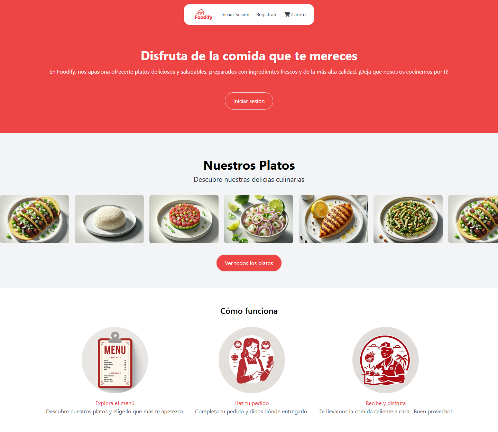
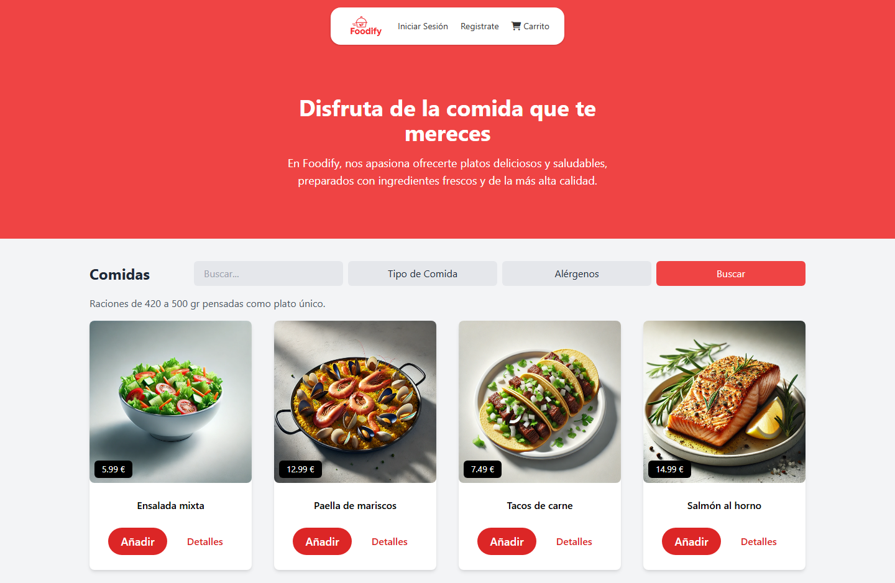
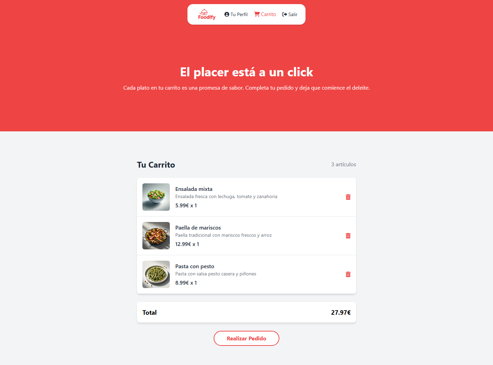
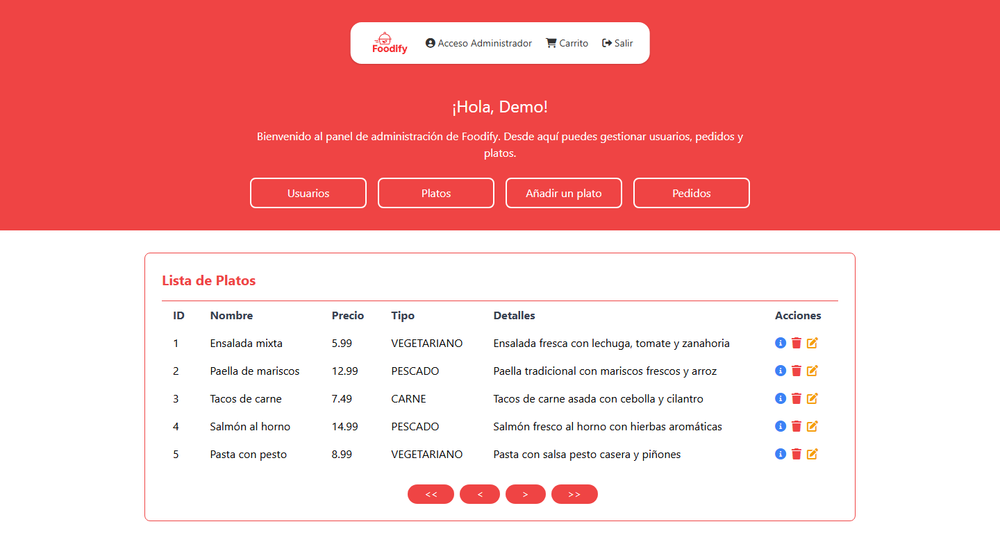

# Foodify

## TFG para el Grado Superior en Desarrollo de Aplicaciones Web

## Descripción

Foodify es una tienda web de comida preparada desarrollada como Trabajo de Fin de Grado del ciclo superior de Desarrollo de Aplicaciones Web. Permite explorar un catálogo de platos, filtrar por tipo y alérgenos, añadir productos al carrito y gestionar pedidos. Incluye cuentas de usuario y vistas para los roles de cliente, administrador y cocina.

El proyecto se desplegó originalmente en **AWS Elastic Beanstalk** e integra **Stripe Checkout** para pagos y **Amazon SES** para notificaciones transaccionales.

> **Estado del proyecto:** Foodify no está desplegado actualmente en AWS. El despliegue en InfinityFree está pendiente y requiere migrar PostgreSQL a MySQL/MariaDB. El código mantiene una integración con Amazon SES para enviar correos.

---

## Funcionalidades

- **Catálogo de platos:** búsqueda por nombre, categorías, detalles e información de alérgenos. Los filtros permiten seleccionar tipos de plato y excluir alérgenos.
- **Carrito de compra:** permite añadir platos, modificar sus cantidades y consultar el importe calculado del carrito. Su contenido se mantiene en la sesión.
- **Cuentas de usuario:** registro, inicio de sesión con verificación de contraseñas mediante hash y edición del perfil.
- **Gestión por roles:** vistas de administración para usuarios, platos y pedidos, y una vista de cocina para gestionar el estado de los pedidos.
- **Imágenes de platos:** carga de archivos JPEG, PNG y WebP, con conversión a WebP mediante GD.
- **Integraciones externas:** código de Stripe Checkout para el pago y Amazon SES para correos de bienvenida y cambios de estado. Estos flujos requieren configuración y validación completa antes de utilizarlos con datos o pagos reales.

## Tecnologías utilizadas

- **HTML5 y CSS3:** estructura y estilos de las vistas.
- **Tailwind CSS 2.2.19:** diseño de la interfaz, cargado mediante CDN.
- **JavaScript:** interacciones del catálogo, carrito y paneles.
- **PHP con PDO PostgreSQL:** lógica de la aplicación organizada en modelos, vistas y controladores.
- **PostgreSQL:** usuarios, platos, alérgenos, pedidos y sus relaciones.
- **Composer:** gestión de dependencias. El archivo de bloqueo incluye `stripe/stripe-php` 17.3.0, `vlucas/phpdotenv` 5.6.2 y `aws/aws-sdk-php` 3.344.2.
- **Stripe Checkout y Amazon SES:** integraciones de pago y correo, respectivamente.
- **AWS Elastic Beanstalk:** plataforma utilizada para el despliegue original del proyecto.

Las dependencias bloqueadas establecen un mínimo técnico de PHP 8.1. Para preparar el entorno, utiliza **PHP 8.4 o 8.5 con sus actualizaciones de seguridad vigentes**.

## Instalación

1. Clona el repositorio e instala las dependencias localmente con Composer:

   ```bash
   git clone https://github.com/sesmerov/foodify.git
   cd foodify
   composer install
   ```

2. Crea una base de datos PostgreSQL e importa el esquema y los datos iniciales de [ecommerce.sql](app/models/dat/ecommerce.sql) mediante pgAdmin o `psql`. La aplicación utiliza el esquema `public` y conecta al puerto 5432.

3. Crea los archivos de configuración local a partir de las plantillas:

   ```bash
   cp app/config/example-configDB.php app/config/configDB.php
   cp app/.env-example app/.env
   ```

4. Configura `DB_SERVER`, `DB_USER`, `DB_PASSWD` y `DATABASE` en el archivo local de conexión. En el archivo de entorno, configura las claves de prueba de Stripe y `APP_URL` con la URL base de la aplicación, sin barra final. Para los correos, configura `AWS_REGION`, `AWS_ACCESS_KEY_ID`, `AWS_SECRET_ACCESS_KEY` y `SES_FROM_EMAIL`. Conserva las credenciales fuera de Git.

5. Habilita PDO PostgreSQL, cURL, mbstring, SimpleXML, iconv, Fileinfo y GD con soporte WebP. También se utilizan JSON, PCRE, sesiones y subida de archivos. El directorio [app/uploads/dishes](app/uploads/dishes) necesita permisos de escritura para gestionar las imágenes.

6. Configura Apache con PHP y la raíz del repositorio como document root. El punto de entrada es [index.php](index.php) y las rutas de la aplicación son relativas. Conserva la protección de [app/.htaccess](app/.htaccess); en otros servidores, configura reglas equivalentes para impedir el acceso directo a configuración, archivos de entorno, SQL y otros archivos privados.

**Antes de arrancar en Linux:** revisa la diferencia de mayúsculas entre el include de `OrderController.php` en el punto de entrada y el archivo real [orderController.php](app/controllers/orderController.php).

La instalación local no implica compatibilidad directa con InfinityFree: el código y el esquema actuales dependen de PostgreSQL.

## Archivos principales

- [index.php](index.php): entrada de la aplicación y despacho de acciones GET y POST.
- [app/controllers](app/controllers): operaciones de usuarios, platos y pedidos.
- [app/models](app/models): entidades y acceso a PostgreSQL con PDO.
- [app/views](app/views): catálogo, autenticación, carrito y paneles.
- [ecommerce.sql](app/models/dat/ecommerce.sql): esquema y datos iniciales.
- [app/.env-example](app/.env-example) y [example-configDB.php](app/config/example-configDB.php): plantillas de configuración local.
- [app/helpers/emailHelper.php](app/helpers/emailHelper.php): envío de correos mediante Amazon SES.
- [web](web): estilos, JavaScript, iconos e imágenes de la interfaz.
- [composer.json](composer.json) y [composer.lock](composer.lock): dependencias de PHP y versiones bloqueadas.

## Cómo usar

1. Abre la aplicación en el servidor local configurado.
2. Explora el catálogo, busca platos y aplica los filtros por tipo o alérgenos.
3. Crea una cuenta de cliente e inicia sesión para editar el perfil y preparar un pedido.
4. Añade platos al carrito y ajusta sus cantidades.
5. Valida el flujo de compra únicamente con el entorno de pruebas de Stripe hasta completar las comprobaciones de pago del servidor.
6. Con una cuenta del rol correspondiente, accede a las vistas de administración o cocina para gestionar el catálogo y los pedidos.

## Capturas de pantalla

Capturas de la aplicación ejecutada en un entorno local con una base de datos de demostración.

### Inicio



### Catálogo



### Carrito



### Administración



## Live Demo

Actualmente no hay una URL de demostración pública confirmada. El despliegue en InfinityFree sigue pendiente.

## Mejoras futuras y preparación del despliegue

- Migrar el esquema y las consultas de PostgreSQL a MySQL/MariaDB antes de desplegar en InfinityFree.
- Completar las comprobaciones de permisos y roles en cada operación y añadir protección CSRF a los formularios.
- Recalcular el importe en el servidor y verificar el pago con Stripe antes de registrar un pedido como pagado. Comprobar la compatibilidad del alojamiento con las notificaciones necesarias para ese flujo.
- Escapar la salida HTML de forma consistente y reforzar la validación de entradas e imágenes.
- Actualizar las dependencias y repetir `composer audit --locked` antes de publicar: la auditoría de las versiones bloqueadas detectó avisos de seguridad en paquetes. Estos avisos requieren revisión según el uso real de cada dependencia.
- Añadir pruebas automatizadas de los flujos principales y validar las integraciones de correo y pago con el entorno configurado.

## Créditos

Proyecto realizado en colaboración por **Diego Sesmero Fernández**, **Aylin Meynioglu** y **Nelson de los Santos** como Trabajo de Fin de Grado del ciclo superior de Desarrollo de Aplicaciones Web.
